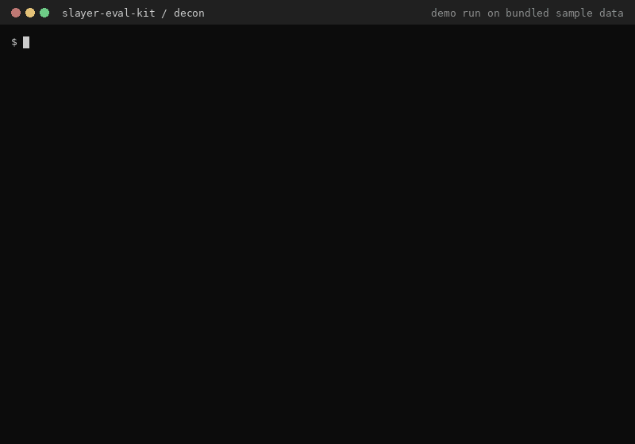

# slayer-eval-kit

  

**Check whether your Polish LLM training corpus contains benchmark test items before you train, and measure MCQ accuracy two ways (generative letter vs likelihood) on a laptop.**



<sub>Demo run on the bundled sample data (`decon/fixtures/`, 17 synthetic documents with planted contamination). Polish version of this README: [README.pl.md](README.pl.md).</sub>

## Why

If benchmark test items leak into your training data, every score you publish afterwards is inflated. That is easy to do by accident with web-scale Polish corpora. This kit was built as a contribution to [Slayer](https://slayer.fabryka.ai), an open applied-research lab for Polish LLMs, whose first rule is "held-out or nothing". Each module runs with one command on a CPU and ends in an artifact you can open and check.

## Modules

| Module | What it does |
|---|---|
| [`decon/`](decon/) | Decontamination: word n-gram (default 13) overlap between a training corpus and test sets, optional diacritic folding, MinHash near-duplicates (`datasketch`) and embedding paraphrase detection (`sentence-transformers`). Outputs an aggregate-only Markdown report and a JSONL manifest of corpus rows to remove. |
| [`mcq/`](mcq/) | Multiple-choice harness for a local Ollama model (stdlib HTTP), scoring each item in `generative` (model writes the letter) and/or `likelihood` mode, with option shuffling, few-shot pool and fixed seed. A result card generator is included. |
| [`morph-ext/`](morph-ext/) | Method for extending the Polish Morphology Benchmark (collective numerals, reflexive verbs, imperative, consonant alternations): vendored evaluator plus result-card generators. The held-out test set itself is intentionally not published. |

## Quick start

```bash
git clone https://github.com/kamilkaczmareksolutions/slayer-eval-kit.git
cd slayer-eval-kit

# decon: pure standard library, no install needed
python -m decon --corpus decon/fixtures/corpus_sample.jsonl \
                --tests  decon/fixtures/tests_sample.jsonl \
                --report report.md --manifest manifest.jsonl

# add diacritic folding + MinHash near-dups
pip install datasketch
python -m decon --corpus decon/fixtures/corpus_sample.jsonl \
                --tests  decon/fixtures/tests_sample.jsonl \
                --fold-diacritics --minhash --shingle 3 --minhash-threshold 0.6 \
                --report report.md --manifest manifest.jsonl

# mcq: needs a local Ollama server (e.g. `ollama pull llama3.2:3b`)
python -m mcq --data mcq/data/test_mcq.jsonl --fewshot mcq/data/fewshot_mcq.jsonl \
              --model ollama/llama3.2:3b --mode both --n-shots 5 \
              --save results.json
```

## How decon works

1. Builds an in-memory n-gram index of the (small) test sets; the (large) corpus is streamed document by document.
2. Flags a corpus document when it shares n-grams with a test item (`--min-hits`, `--min-containment`), optionally after folding Polish diacritics to ASCII.
3. Optional tiers: `--minhash` (Jaccard near-duplicates) and `--embed` (cosine similarity, CPU).
4. Writes a report with aggregates only (contamination per test set, short diagnostic snippets) and a manifest with one line per contaminated `corpus_id` and the reasons.

On the bundled fixtures the lexical tiers catch 4/17 documents (verbatim), then 6/17 with diacritic folding + MinHash. The planted paraphrase is only caught by `--embed`: that's where lexical decontamination ends. A run on real public Polish test sets is described in [`decon/reports/REAL_RUN.md`](decon/reports/REAL_RUN.md); sample MCQ results for `llama3.2:3b` and `qwen2.5:3b` are in [`mcq/results/RESULT_CARD.md`](mcq/results/RESULT_CARD.md).

## Limitations

- Module docs, CLI help and console messages are in Polish.
- n-gram and MinHash only catch lexical overlap; paraphrases need the heavier `--embed` tier.
- `mcq` talks only to a local Ollama server (`localhost:11434`); likelihood mode reads `top_logprobs` of the first answer token.
- `morph-ext` needs the held-out test file, which is not in this repo.
- Built and tested on Windows 11 + Python 3.10 (laptop CPU, 4 GB VRAM GPU for local models).

## License

MIT, see [LICENSE](LICENSE). Test data and results are for **evaluation only** (decontamination before training), not for training.
